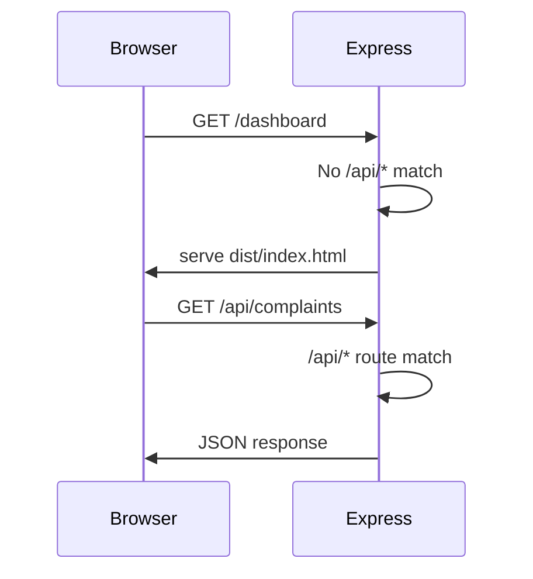

# Design Document: AI Civic Complaint Capture

## Overview

This feature adds AI-powered complaint capture to the FixMyCity Expo mobile app. Citizens photograph a civic issue, the image is uploaded to Cloudinary and analyzed by Claude claude-3-5-haiku-20241022 (Anthropic), and the resulting structured data pre-fills a complaint form. The feature also resolves two infrastructure issues: serving the React authority portal from the same Express server (port unification) and fixing the MongoDB Atlas connection string.

### Key Design Decisions

- **Single-port architecture**: Express serves both the API and the built React SPA. This eliminates CORS configuration and simplifies deployment.
- **Cloudinary-first upload**: The image is uploaded to Cloudinary before the LLM call so the AI receives a stable public URL rather than a base64 blob, keeping the Claude request small and the image permanently stored regardless of analysis outcome.
- **15-second dual timeout**: Both the server (AbortController on the Claude call) and the mobile client (AbortController on the fetch) enforce a 15-second limit independently, so a slow network and a slow LLM are both handled.
- **Severity normalization at ingestion**: The mobile app sends lowercase severity values from the AI response; the backend normalizes to uppercase before persisting, keeping the Complaint model enum clean.
- **Claude vision via base64**: Claude's Messages API accepts images as base64-encoded data URIs. The backend fetches the Cloudinary image, encodes it to base64, and sends it as `image` content type in the user message alongside the civic-issue prompt.
- **Mobile app already exists**: The Expo app at `FixMyCityCitizen_App/` already has `report.tsx` with the full AI autofill flow, `expo-image-picker`, `expo-location`, and `api.js` with `postForm`. No scaffolding needed — only the backend AI provider needs to change.

---

## Architecture

```mermaid
graph TD
    A[Citizen - Expo App] -->|multipart/form-data POST /api/complaints/analyze-image| B[Express API Server :5000]
    B -->|upload_stream buffer| C[Cloudinary CDN]
    C -->|secure_url| B
    B -->|image_url content + prompt| D[Anthropic Claude claude-3-5-haiku-20241022 Vision]
    D -->|JSON text| B
    B -->|{ isCivicIssue, category, severity, description, imageUrl }| A
    A -->|pre-filled form, citizen edits| A
    A -->|POST /api/complaints| B
    B -->|create document| E[MongoDB Atlas]
    E -->|complaint doc| B
    B -->|HTTP 201 complaint| A

    F[Authority Portal - React SPA] -->|GET /| B
    B -->|static dist/ files| F
```

### Port Unification Flow



---

## Components and Interfaces

### Backend Components

#### `server.js` (modified)
- Add `express.static(path.join(__dirname, '../fixmycity-authority-portal-main/FixMyCity-authority-portal-main/dist'))` after all API route mounts.
- Add catch-all `app.get('*', ...)` that serves `index.html` for SPA client-side routing.
- Validate `ANTHROPIC_API_KEY` presence on startup; log warning if missing.

#### `config/db.js` (modified)
- Append `?retryWrites=true&w=majority` to the connection string if not already present.
- Improve error logging to hint at IP whitelist issues when the error code is `ECONNREFUSED` or Atlas-specific codes.

#### `controllers/analyzeImageController.js` (new)

```
analyzeImage(req, res)
  ├── multer memoryStorage middleware (applied at route level)
  ├── Guard: ANTHROPIC_API_KEY missing → 503
  ├── Guard: no file in req.file → 400
  ├── Upload req.file.buffer to Cloudinary via upload_stream → imageUrl
  │     └── failure → 502
  ├── Fetch Cloudinary image → encode to base64 (for Claude Messages API)
  ├── Call Claude claude-3-5-haiku-20241022 with base64 image + civic prompt, 15s AbortController timeout
  │     └── timeout → 504
  ├── Parse JSON from Claude response text (strip markdown fences if present)
  │     └── parse failure → 422
  ├── Validate/normalize schema fields
  └── Return 200 { isCivicIssue, category, severity, description, imageUrl }
```

#### `routes/complaintRoutes.js` (modified)
- Add `POST /analyze-image` **before** `GET /:id` to avoid Express treating `analyze-image` as a param.
- Add severity normalization (`.toUpperCase()`) in `createComplaint` before persisting.

#### Mobile: `app/report.tsx` (already implemented)

The screen already exists at `FixMyCityCitizen_App/FixMyCityCitizen_App/app/report.tsx` with the full flow:

```
ReportScreen (existing)
  ├── capturePhoto() — camera only (gallery disabled), records capturedAt + captureLocation
  ├── uploadImage() — immediate Cloudinary upload on capture via /api/upload
  ├── analyzeImage() — "✨ AI Autofill" button, AbortController 60s timeout
  │     ├── POST /api/complaints/analyze-image with FormData
  │     ├── success + isCivicIssue:true → pre-fills category/severity/description
  │     ├── success + isCivicIssue:false → shows "not a civic issue" warning
  │     └── failure/timeout → Alert + fallback upload + empty editable form
  ├── ComplaintForm — category chips, severity chips, description (+ voice), location
  └── handleSubmit() — POST /api/complaints with all fields + capturedAt + captureLocation
```

No mobile changes needed — the screen already calls `POST /api/complaints/analyze-image` and handles all response cases. Only the backend AI provider changes.

### API Contract

#### `POST /api/complaints/analyze-image`

| | |
|---|---|
| Auth | Bearer JWT (required) |
| Content-Type | `multipart/form-data` |
| Field | `image` (file) |

**Success 200:**
```json
{
  "isCivicIssue": true,
  "category": "pothole",
  "severity": "high",
  "description": "Large pothole on road surface causing hazard",
  "imageUrl": "https://res.cloudinary.com/dlaa15fd0/image/upload/v.../abc.jpg"
}
```

**Error responses:**

| Status | Condition | Body |
|--------|-----------|------|
| 400 | No image file | `{ "error": "No image file provided" }` |
| 401 | Missing/invalid JWT | `{ "error": "No token" }` |
| 422 | LLM returned non-JSON | `{ "error": "AI returned unparseable response" }` |
| 502 | Cloudinary upload failed | `{ "error": "Image upload failed" }` |
| 503 | ANTHROPIC_API_KEY missing | `{ "error": "AI service not configured" }` |
| 504 | LLM call timed out | `{ "error": "AI analysis timed out" }` |

#### `POST /api/complaints` (modified behavior)

Accepts `severity` as `low | medium | high` (case-insensitive); normalizes to `LOW | MEDIUM | HIGH` before persisting.

---

## Data Models

### Complaint (existing — no schema change)

```js
{
  userId:      ObjectId (ref: User),
  description: String,
  imageUrl:    String,
  category:    String,
  severity:    "LOW" | "MEDIUM" | "HIGH",
  location:    { lat: Number, lng: Number, address: String },
  status:      "RECEIVED" | "JOB_CREATED" | "IN_PROGRESS" | "COMPLETED",
  createdAt:   Date,
  updatedAt:   Date
}
```

The severity enum remains uppercase. Normalization happens in the controller before `Complaint.create()`.

### AI Analysis Response (transient — not persisted)

```ts
interface AIAnalysis {
  isCivicIssue: boolean;
  category:    "pothole" | "garbage" | "water_leak" | "streetlight" | "road_damage" | "other" | null;
  severity:    "low" | "medium" | "high" | null;
  description: string | null;
  imageUrl:    string;  // Cloudinary URL
}
```

### Mobile Form State

```ts
interface ComplaintFormState {
  imageUri:    string | null;   // local device URI for preview
  imageUrl:    string | null;   // Cloudinary URL after upload/analysis
  category:    string;
  severity:    string;
  description: string;
  location:    { lat: number; lng: number; address: string } | null;
  isAnalyzing: boolean;
  isFallback:  boolean;
}
```

---


## Correctness Properties

*A property is a characteristic or behavior that should hold true across all valid executions of a system — essentially, a formal statement about what the system should do. Properties serve as the bridge between human-readable specifications and machine-verifiable correctness guarantees.*

### Property 1: Non-API paths always return SPA HTML

*For any* request path that does not begin with `/api/`, the Express server should respond with the contents of `index.html` (the React SPA entry point), regardless of what the path is.

**Validates: Requirements 1.2**

---

### Property 2: API paths are never intercepted by static middleware

*For any* request path that begins with `/api/`, the response should never be the SPA `index.html` — it should always be a JSON API response.

**Validates: Requirements 1.3**

---

### Property 3: MONGO_URI always includes required Atlas parameters

*For any* `MONGO_URI` value passed to `connectDB`, the connection string used by mongoose should always contain both `retryWrites=true` and `w=majority` parameters, whether or not they were present in the original string.

**Validates: Requirements 2.3**

---

### Property 4: Auth middleware rejects all unauthenticated requests to analyze-image

*For any* request to `POST /api/complaints/analyze-image` that either has no `Authorization` header or carries an invalid/expired JWT, the server should always return HTTP 401 before any image processing occurs.

**Validates: Requirements 4.2, 4.3**

---

### Property 5: LLM prompt always embeds the Cloudinary image URL

*For any* successfully uploaded image that produces a Cloudinary URL, the Claude API call constructed by `analyzeImageController` should always include the base64-encoded image data derived from that URL in the `image` content block of the user message.

**Validates: Requirements 4.5**

---

### Property 6: Non-JSON LLM responses always return HTTP 422

*For any* string returned by the LLM that cannot be parsed as valid JSON (including empty strings, HTML error pages, plain text, truncated JSON), the `analyzeImageController` should always return HTTP 422 with `{ "error": "AI returned unparseable response" }`.

**Validates: Requirements 4.9**

---

### Property 7: AI analysis response always conforms to schema

*For any* valid image input that results in a successful LLM call, the HTTP 200 response body should always conform to the full schema:
- `isCivicIssue` is a boolean
- when `isCivicIssue` is `true`: `category` is one of `["pothole", "garbage", "water_leak", "streetlight", "road_damage", "other"]`, `severity` is one of `["low", "medium", "high"]`, `description` is a non-null string
- when `isCivicIssue` is `false`: `category`, `severity`, and `description` are all `null`
- `imageUrl` is a non-empty string

**Validates: Requirements 5.1, 5.2, 5.3, 5.4**

---

### Property 8: imageUrl round-trip — upload produces accessible URL

*For any* image buffer uploaded to Cloudinary via `analyzeImageController`, the returned `imageUrl` should be a valid HTTPS URL pointing to the uploaded resource (i.e., the URL is non-empty, starts with `https://res.cloudinary.com`, and the resource is accessible).

**Validates: Requirements 5.5**

---

### Property 9: Pre-fill populates all form fields and keeps them editable

*For any* AI analysis response where `isCivicIssue` is `true`, the mobile `ComplaintFormState` should have `category`, `severity`, and `description` set to the values from the response, and all three fields should remain editable (not read-only) by the citizen.

**Validates: Requirements 6.1, 6.2**

---

### Property 10: isCivicIssue false leaves form fields empty

*For any* AI analysis response where `isCivicIssue` is `false`, the mobile `ComplaintFormState` should have `category`, `severity`, and `description` all set to empty strings (not pre-filled), and the "not a civic issue" message should be displayed.

**Validates: Requirements 6.3**

---

### Property 11: Fallback on failure preserves image and presents empty editable form

*For any* failed `POST /api/complaints/analyze-image` call (network error, non-200 status, or client-side 15s timeout), the mobile app should: show the fallback toast message, leave `category`, `severity`, and `description` empty and editable, and retain the `imageUri` that was captured before the failed request.

**Validates: Requirements 7.1, 7.2, 7.4**

---

### Property 12: Severity normalization is total and correct

*For any* severity string in `["low", "medium", "high", "Low", "Medium", "High", "LOW", "MEDIUM", "HIGH"]`, the normalization function should always produce the corresponding uppercase value `["LOW", "MEDIUM", "HIGH"]`. No valid input should ever be rejected or produce an unexpected value.

**Validates: Requirements 8.3**

---

### Property 13: Complaint submission round-trip

*For any* valid complaint payload (non-empty description, valid category, valid severity), submitting `POST /api/complaints` should return HTTP 201 with a document that contains the same `description`, normalized `severity` (uppercase), and `category` that were submitted.

**Validates: Requirements 8.4**

---

### Property 14: Empty description always blocks mobile submission

*For any* `ComplaintFormState` where `description` is an empty string or contains only whitespace characters, the submit action should be blocked, a validation error should be displayed, and no HTTP request should be sent to `POST /api/complaints`.

**Validates: Requirements 8.5**

---

## Error Handling

### Backend Error Matrix

| Scenario | HTTP Status | Response Body | Recovery |
|----------|-------------|---------------|----------|
| No JWT / invalid JWT | 401 | `{ "error": "No token" }` | Client must re-authenticate |
| No image file in request | 400 | `{ "error": "No image file provided" }` | Client must attach file |
| ANTHROPIC_API_KEY not set | 503 | `{ "error": "AI service not configured" }` | Operator must set env var |
| Cloudinary upload fails | 502 | `{ "error": "Image upload failed" }` | Retry or use fallback |
| LLM call times out (>15s) | 504 | `{ "error": "AI analysis timed out" }` | Mobile triggers fallback |
| LLM returns non-JSON | 422 | `{ "error": "AI returned unparseable response" }` | Mobile triggers fallback |
| Unexpected server error | 500 | `{ "error": "Internal server error" }` | Log and investigate |

### Mobile Error Handling

- **Network error / non-200 from analyze-image**: Show toast "AI analysis unavailable, please fill in manually", present empty editable form.
- **Client-side 15s timeout**: `AbortController.abort()` fires, same fallback as above.
- **isCivicIssue: false**: Show inline message, do not pre-fill form, allow manual entry.
- **Permission denied (camera/library)**: Show alert with link to device Settings.
- **Empty description on submit**: Inline validation error, no request sent.

### MongoDB Connection Errors

`config/db.js` will detect Atlas-specific error patterns and log actionable messages:
- `ECONNREFUSED` or `MongoServerSelectionError` → log hint about IP whitelist (`0.0.0.0/0` in Atlas Network Access).
- Any connection failure → `process.exit(1)` to prevent the server from running in a broken state.

---

## Testing Strategy

### Dual Testing Approach

Both unit tests and property-based tests are required. They are complementary:
- **Unit tests** cover specific examples, integration points, and error conditions.
- **Property-based tests** verify universal properties across many generated inputs.

### Property-Based Testing

**Library**: `fast-check` (already in `devDependencies`)

Each property-based test runs a minimum of **100 iterations** and is tagged with a comment referencing the design property it validates.

Tag format: `// Feature: ai-civic-complaint-capture, Property {N}: {property_text}`

**Properties to implement as PBT tests:**

| Property | Test Description | Generator |
|----------|-----------------|-----------|
| P1 | Non-API paths → index.html | `fc.string()` filtered to not start with `/api/` |
| P2 | API paths → JSON, never HTML | `fc.string()` mapped to `/api/${s}` |
| P3 | MONGO_URI always has retryWrites + w=majority | `fc.string()` as URI input |
| P4 | Unauthenticated requests → 401 | `fc.option(fc.string())` for auth header |
| P6 | Non-JSON LLM response → 422 | `fc.string()` filtered to not be valid JSON |
| P7 | Response schema always valid | `fc.record(...)` generating mock LLM responses |
| P9 | Pre-fill populates fields | `fc.record(...)` generating AIAnalysis with isCivicIssue:true |
| P10 | isCivicIssue:false → empty form | `fc.record(...)` generating AIAnalysis with isCivicIssue:false |
| P11 | Fallback preserves image | `fc.oneof(fc.constant('network-error'), fc.integer({min:400,max:599}))` |
| P12 | Severity normalization | `fc.constantFrom('low','medium','high','Low','Medium','High','LOW','MEDIUM','HIGH')` |
| P13 | Complaint submission round-trip | `fc.record({description: fc.string({minLength:1}), severity: fc.constantFrom(...), category: fc.constantFrom(...)})` |
| P14 | Empty description blocks submit | `fc.string()` filtered to be blank/whitespace only |

### Unit Tests

Unit tests focus on specific examples, integration points, and error conditions not covered by PBT:

- **`analyzeImageController`**: mock Cloudinary failure → 502; mock missing API key → 503; mock LLM timeout → 504; mock valid LLM response → 200 with correct shape.
- **`complaintRoutes`**: verify `/analyze-image` route is registered before `/:id`; verify `protect` middleware is applied.
- **`server.js`**: verify static middleware is mounted after all `/api/*` routes; verify catch-all serves `index.html`.
- **`config/db.js`**: mock `mongoose.connect` throwing → verify `process.exit(1)` called and error message contains Atlas hint.
- **Mobile `ReportScreen`**: permission denied → alert shown; `isCivicIssue:false` → message shown, form empty; loading state → submit button disabled.

### Test File Locations

```
backend/
  __tests__/
    analyzeImage.property.test.js   # PBT: P4, P6, P7, P12, P13
    analyzeImage.unit.test.js       # Unit: error conditions, mocked integrations
    complaintRoutes.test.js         # Unit: route ordering, middleware
    server.unit.test.js             # Unit: static serving, catch-all
    db.unit.test.js                 # Unit: connection error handling, P3

mobile/
  __tests__/
    ReportScreen.property.test.js   # PBT: P9, P10, P11, P14
    ReportScreen.unit.test.js       # Unit: permissions, loading state
```

### Dependencies to Add

**Backend:**
```bash
npm install @anthropic-ai/sdk
```

**Mobile (Expo):**
Already installed — `expo-image-picker`, `expo-location`, and `api.js` with `postForm` are all present in `FixMyCityCitizen_App/`. No additional packages needed.
