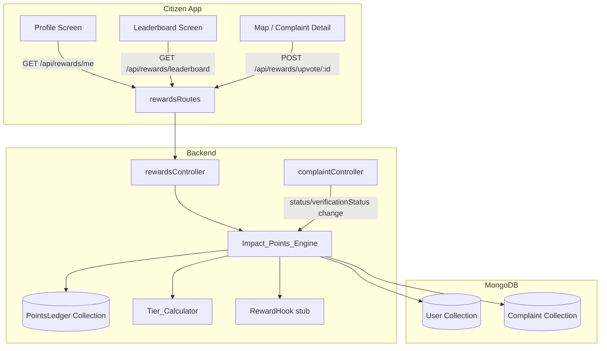

# Design Document — Gamified Rewards (Impact Points)

## Overview

The Gamified Rewards feature adds an **Impact Points** system to the FixMyCity citizen app. Citizens accumulate points through two civic actions: submitting complaints that get verified/resolved, and upvoting nearby complaints reported by others. Points drive a three-tier progression ladder (Bronze → Silver → Gold) displayed on the citizen's profile screen. A leaderboard fosters community engagement. The system is architected to be future-ready, with a stub `RewardHook` interface that can be swapped for a real redemption integration without touching the points or tier logic.

The feature spans three layers:
- **Backend** (Node.js/Express + MongoDB/Mongoose): new `PointsLedger` model, `rewardsController`, `rewardsRoutes`, and event hooks wired into the existing complaint update flow.
- **Citizen App** (React Native/Expo): new profile screen sections and a leaderboard screen consuming the Rewards API.
- **Authority Portal**: read-only; no changes required for this feature.

---

## Architecture



### Key Design Decisions

1. **Append-only ledger over a mutable counter** — storing every point transaction as an immutable document makes auditing trivial, prevents silent corruption, and makes idempotency checks straightforward (query by `citizenId + referenceId + reason`).

2. **Hooks in `complaintController`, not Mongoose middleware** — wiring point awards inside the existing `updateComplaintStatus` controller (and a new `updateVerificationStatus` path) keeps the trigger logic explicit and testable without hidden side-effects from Mongoose `post` hooks.

3. **`Tier_Calculator` as a pure function** — tier is always derived on-the-fly from the ledger sum rather than stored. This avoids stale-tier bugs and keeps the data model simple. The cost is one aggregation query per profile fetch, which is acceptable at this scale.

4. **Upvote stored on the Complaint document** — a `upvotedBy: [ObjectId]` array on `Complaint` is the simplest way to enforce the one-upvote-per-citizen constraint with a single atomic `$addToSet` + duplicate check, without a separate Upvote collection.

---

## Components and Interfaces

### Backend

#### `PointsLedger` Model (`backend/models/PointsLedger.js`)
Stores every point transaction. Append-only — no updates or deletes.

#### `Impact_Points_Engine` (`backend/services/impactPointsEngine.js`)
Pure service module (no Express dependency). Exposes:
- `awardPoints(citizenId, points, reason, referenceId)` — creates a ledger entry after idempotency check.
- `getTotalPoints(citizenId)` — aggregates ledger sum.
- `getLedger(citizenId, limit)` — returns sorted, capped ledger entries.

#### `Tier_Calculator` (`backend/services/tierCalculator.js`)
Pure function module:
- `calculateTier(totalPoints)` → `'BRONZE' | 'SILVER' | 'GOLD'`

#### `RewardHook` (`backend/services/rewardHook.js`)
Stub interface:
- `triggerRedemption(citizenId, rewardId)` → `{ status: 'NOT_IMPLEMENTED' }`

#### `rewardsController` (`backend/controllers/rewardsController.js`)
Express handlers:
- `getMyRewards(req, res)` — serves `GET /api/rewards/me`
- `getLeaderboard(req, res)` — serves `GET /api/rewards/leaderboard`
- `upvoteComplaint(req, res)` — serves `POST /api/rewards/upvote/:complaintId`
- `redeemReward(req, res)` — serves `POST /api/rewards/redeem`

#### `rewardsRoutes` (`backend/routes/rewardsRoutes.js`)
Mounts all reward endpoints under `/api/rewards`, all protected by the existing `protect` middleware.

#### Modifications to existing files
- `complaintController.js` — `updateComplaintStatus` calls `awardPoints` when status transitions to `COMPLETED`; a new `updateVerificationStatus` handler calls `awardPoints` when `verificationStatus` transitions to `VERIFIED`.
- `server.js` — registers `rewardsRoutes`.
- `Complaint.js` model — adds `upvotedBy: [{ type: ObjectId, ref: 'User' }]` field.

### Citizen App

#### `app/profile.tsx` (new screen)
Displays `totalPoints`, tier badge, and scrollable ledger history. Fetches from `GET /api/rewards/me`.

#### `app/leaderboard.tsx` (new screen)
Ranked list of top 20 citizens. Fetches from `GET /api/rewards/leaderboard`. Highlights the authenticated user's row.

#### `components/TierBadge.tsx` (new component)
Renders a coloured badge based on tier string. Bronze = `#CD7F32`, Silver = `#C0C0C0`, Gold = `#FFD700`.

#### `services/api.js` — additions
```js
rewards: {
  getMe: () => api.get('/rewards/me'),
  getLeaderboard: () => api.get('/rewards/leaderboard'),
  upvote: (complaintId) => api.post(`/rewards/upvote/${complaintId}`),
  redeem: (body) => api.post('/rewards/redeem', body),
}
```

---

## Data Models

### `PointsLedger` (new MongoDB collection)

```js
{
  citizenId:   { type: ObjectId, ref: 'User', required: true, index: true },
  points:      { type: Number, required: true },          // always positive
  reason:      { type: String, required: true },          // e.g. 'COMPLAINT_VERIFIED'
  referenceId: { type: ObjectId, required: true },        // Complaint ObjectId
  createdAt:   { type: Date, default: Date.now, index: true }
}
```

Valid `reason` values (constants):
| Constant | Points | Trigger |
|---|---|---|
| `COMPLAINT_VERIFIED` | 10 | `verificationStatus → VERIFIED` |
| `COMPLAINT_COMPLETED` | 20 | `status → COMPLETED` |
| `UPVOTE_CAST` | 5 | Citizen upvotes another's complaint |

Idempotency index (unique compound):
```js
{ citizenId: 1, referenceId: 1, reason: 1 }  // unique: true
```

### `Complaint` model — additions

```js
upvotedBy: [{ type: mongoose.Schema.Types.ObjectId, ref: 'User', default: [] }]
```

### `User` model — no changes
Tier and total points are derived at query time from the ledger; they are not stored on the User document.

### API Response Shapes

**`GET /api/rewards/me`**
```json
{
  "totalPoints": 215,
  "tier": "SILVER",
  "ledger": [
    { "points": 20, "reason": "COMPLAINT_COMPLETED", "referenceId": "...", "createdAt": "..." },
    ...
  ]
}
```

**`GET /api/rewards/leaderboard`**
```json
[
  { "username": "alice", "totalPoints": 540, "tier": "GOLD" },
  ...
]
```

**`POST /api/rewards/redeem`**
```json
HTTP 501
{ "message": "Reward redemption is coming soon." }
```

---

## Correctness Properties

*A property is a characteristic or behavior that should hold true across all valid executions of a system — essentially, a formal statement about what the system should do. Properties serve as the bridge between human-readable specifications and machine-verifiable correctness guarantees.*

### Property 1: Verified complaint awards exactly 10 points

*For any* citizen and any complaint owned by that citizen, when the complaint's `verificationStatus` transitions to `VERIFIED`, the citizen's ledger should gain exactly one new entry with `points = 10` and `reason = 'COMPLAINT_VERIFIED'`.

**Validates: Requirements 1.1**

---

### Property 2: Completed complaint awards exactly 20 points

*For any* citizen and any complaint owned by that citizen, when the complaint's `status` transitions to `COMPLETED`, the citizen's ledger should gain exactly one new entry with `points = 20` and `reason = 'COMPLAINT_COMPLETED'`.

**Validates: Requirements 1.2**

---

### Property 3: Ledger entry schema invariant

*For any* point-awarding event (verification, completion, or upvote), the resulting ledger entry must contain all five required fields — `citizenId`, `points`, `reason`, `referenceId`, and `createdAt` — with correct types (`ObjectId`, `Number`, `String`, `ObjectId`, `Date` respectively).

**Validates: Requirements 1.4, 2.2**

---

### Property 4: Point award idempotency

*For any* complaint and any point-awarding event type, triggering the same event N times (N ≥ 1) must produce exactly one ledger entry for that `(citizenId, referenceId, reason)` triple — the total points awarded must not exceed the single-award amount regardless of how many times the event fires.

**Validates: Requirements 1.5**

---

### Property 5: Upvote awards exactly 5 points

*For any* citizen A and any complaint owned by a different citizen B, when citizen A upvotes that complaint, citizen A's ledger should gain exactly one new entry with `points = 5` and `reason = 'UPVOTE_CAST'`.

**Validates: Requirements 2.1**

---

### Property 6: Duplicate upvote rejected with 409

*For any* citizen and any complaint not owned by that citizen, a second upvote request on the same complaint must always return HTTP 409, and the citizen's ledger must not gain an additional entry.

**Validates: Requirements 2.3**

---

### Property 7: Self-upvote rejected with 403

*For any* citizen and any complaint owned by that same citizen, an upvote request must always return HTTP 403, and no ledger entry must be created.

**Validates: Requirements 2.4**

---

### Property 8: Tier assignment correctness

*For any* integer `n ≥ 0`, `calculateTier(n)` must return:
- `'BRONZE'` when `0 ≤ n ≤ 199`
- `'SILVER'` when `200 ≤ n ≤ 499`
- `'GOLD'` when `n ≥ 500`

The three ranges must be exhaustive and mutually exclusive — every non-negative integer maps to exactly one tier.

**Validates: Requirements 3.1, 3.2, 3.3**

---

### Property 9: Tier consistency with ledger sum

*For any* citizen with any set of ledger entries, the `tier` and `totalPoints` values returned by `GET /api/rewards/me` must always equal `calculateTier(sum(ledger.points))` and `sum(ledger.points)` respectively — the API must never return a stale or cached tier that diverges from the current ledger.

**Validates: Requirements 3.4, 3.5**

---

### Property 10: Profile response schema

*For any* authenticated citizen, `GET /api/rewards/me` must always return a JSON object containing exactly the fields `totalPoints` (number), `tier` (one of `'BRONZE'`, `'SILVER'`, `'GOLD'`), and `ledger` (array).

**Validates: Requirements 4.1, 4.2**

---

### Property 11: Ledger ordering and cap

*For any* citizen, the `ledger` array in `GET /api/rewards/me` must always be sorted by `createdAt` descending, and its length must never exceed 50 — when the citizen has more than 50 entries, only the 50 most recent are returned.

**Validates: Requirements 5.1, 5.2**

---

### Property 12: Leaderboard ranking correctness

*For any* set of citizens with varying point totals, `GET /api/rewards/leaderboard` must return at most 20 entries, each containing `username`, `totalPoints`, and `tier`, ordered by `totalPoints` descending — no citizen with a lower total may appear above a citizen with a higher total.

**Validates: Requirements 6.1**

---

## Error Handling

| Scenario | HTTP Status | Response body |
|---|---|---|
| Upvote own complaint | 403 | `{ "error": "Self-upvoting is not permitted" }` |
| Duplicate upvote | 409 | `{ "error": "You have already upvoted this complaint" }` |
| Complaint not found (upvote) | 404 | `{ "error": "Complaint not found" }` |
| Unauthenticated request | 401 | `{ "error": "No token" }` (existing middleware) |
| Redeem endpoint | 501 | `{ "message": "Reward redemption is coming soon." }` |
| DB error in awardPoints | 500 | `{ "error": "Failed to award points" }` — logged server-side; complaint update still succeeds (points failure is non-fatal) |
| FLAGGED complaint | — | No ledger entry created; no error returned to caller |

**Non-fatal point failures**: if `awardPoints` throws (e.g. transient DB error), the complaint status update must still succeed. The engine logs the failure and swallows the error so the authority portal's status update flow is never blocked by the rewards subsystem.

---

## Testing Strategy

### Dual Testing Approach

Both unit tests and property-based tests are required. They are complementary:
- **Unit tests** cover specific examples, integration points, and error conditions.
- **Property tests** verify universal invariants across randomly generated inputs.

### Property-Based Testing

The project already uses **fast-check** (`^3.0.0`) with **Jest** (`^29.0.0`). All property tests follow the existing pattern in `backend/__tests__/analyzeImage.property.test.js`.

Each property test must:
- Run a minimum of **100 iterations** (`{ numRuns: 100 }`).
- Include a header comment in the format:
  `// Feature: gamified-rewards, Property N: <property_text>`
- Reference the design property it validates.

**Property test file**: `backend/__tests__/rewards.property.test.js`

| Design Property | Test description |
|---|---|
| P1 | For any citizenId + complaintId, awardPoints with COMPLAINT_VERIFIED creates exactly one entry with points=10 |
| P2 | For any citizenId + complaintId, awardPoints with COMPLAINT_COMPLETED creates exactly one entry with points=20 |
| P3 | For any award event, the ledger entry always has all 5 required fields with correct types |
| P4 | Calling awardPoints N times with the same (citizenId, referenceId, reason) always results in exactly 1 ledger entry |
| P5 | For any citizen A ≠ complaint owner, upvote creates exactly one entry with points=5 |
| P6 | For any citizen + complaint, a second POST /api/rewards/upvote/:id always returns 409 |
| P7 | For any citizen upvoting their own complaint, POST /api/rewards/upvote/:id always returns 403 |
| P8 | For any integer n ≥ 0, calculateTier(n) returns the correct tier with no gaps or overlaps |
| P9 | For any ledger state, GET /api/rewards/me tier and totalPoints always equal calculateTier(sum) and sum |
| P10 | For any authenticated citizen, GET /api/rewards/me always returns { totalPoints, tier, ledger } |
| P11 | For any citizen with k ledger entries, returned ledger is sorted desc and length ≤ 50 |
| P12 | For any citizen set, leaderboard is sorted desc by totalPoints, length ≤ 20, all entries have required fields |

### Unit Tests

**Unit test file**: `backend/__tests__/rewards.unit.test.js`

Focus areas:
- `calculateTier` boundary values: 0, 199, 200, 499, 500 (edge cases at tier thresholds).
- `awardPoints` with a FLAGGED complaint — assert no ledger entry is created.
- `GET /api/rewards/me` returns correct shape for a citizen with zero ledger entries.
- `POST /api/rewards/redeem` always returns 501 with the correct message.
- `RewardHook.triggerRedemption` returns `{ status: 'NOT_IMPLEMENTED' }`.
- Complaint status update to COMPLETED triggers point award (integration between `complaintController` and `impactPointsEngine`).

### Citizen App Tests

The React Native app does not currently have a test suite. UI correctness for the profile screen and leaderboard is validated manually. The `TierBadge` component colour mapping can be unit-tested with Jest + React Native Testing Library if a test suite is added in future.
