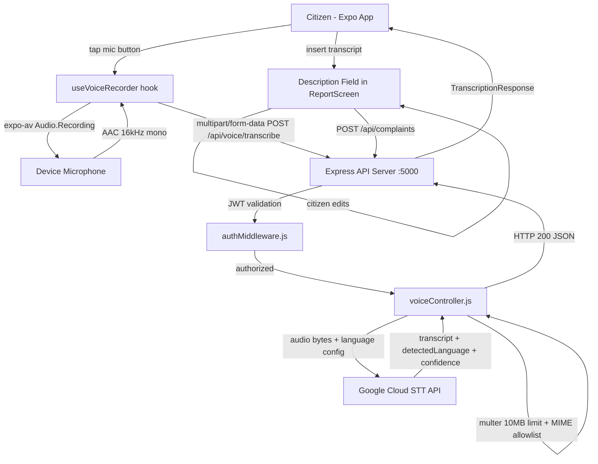
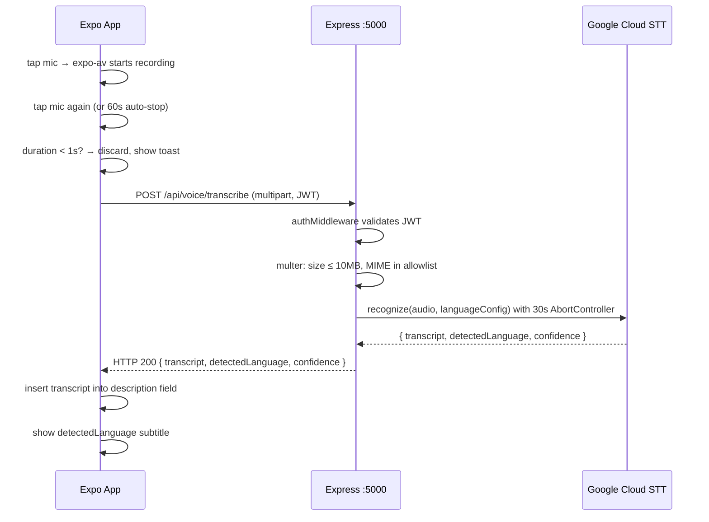

# Design Document: Voice Complaint Input

## Overview

This feature adds Speech-to-Text (STT) voice input to the FixMyCity Expo mobile app. Citizens tap a microphone button on the complaint form, speak their complaint in any of 8 supported Indian languages, and the transcribed text is inserted into the description field. The Google Cloud Speech-to-Text API handles transcription on the backend, keeping the API key off the client. The feature coexists with the existing AI image analysis: voice input can override an AI-pre-filled description, and both paths converge on the same description field before submission.

### Key Design Decisions

- **Backend-proxied STT**: The mobile app never calls Google Cloud STT directly. All audio is sent to `POST /api/voice/transcribe`, which holds the API key server-side and enforces auth.
- **Multilingual auto-detection**: The STT request always includes `en-IN` as primary with 7 Indian language alternatives, so citizens do not need to pre-select a language. A language selector is provided as an optional hint to improve accuracy.
- **30-second dual timeout**: Both the backend (AbortController on the STT call) and the mobile client (AbortController on the fetch) enforce independent 30-second limits.
- **Voice overrides AI**: When voice transcription succeeds after AI image analysis has pre-filled the description, the transcript replaces the AI text. The last-written value always wins.
- **AAC at 16 kHz mono**: The `expo-av` recording is configured to produce AAC audio at 16 kHz mono, which is the optimal format for Google Cloud STT and keeps file sizes small.
- **<1s guard**: Recordings shorter than 1 second are discarded client-side before any network call is made.

---

## Architecture



### Request Flow



---

## Components and Interfaces

### Backend Components

#### `backend/controllers/voiceController.js` (new)

```
voiceController
  ├── Guard: GOOGLE_STT_API_KEY missing → 503
  ├── Guard: req.file missing → 400
  ├── Build Google Cloud STT request
  │     ├── audio: { content: base64(req.file.buffer) }
  │     ├── config.languageCode: languageHint ?? "en-IN"
  │     ├── config.alternativeLanguageCodes: remaining Supported_Languages
  │     └── config.encoding / sampleRateHertz from MIME type
  ├── Call STT REST API with 30s AbortController timeout
  │     ├── timeout → 504 { "error": "Transcription timed out" }
  │     └── network error → 502 { "error": "STT service unavailable" }
  ├── Extract transcript, languageCode, confidence from response
  │     └── empty results → 200 { transcript: "", detectedLanguage: null, confidence: 0.0 }
  └── Return 200 { transcript, detectedLanguage, confidence }
```

#### `backend/routes/voiceRoutes.js` (new)

```js
import { Router } from 'express';
import { protect } from '../middleware/authMiddleware.js';
import { upload, transcribe } from '../controllers/voiceController.js';

const router = Router();
router.post('/transcribe', protect, upload.single('audio'), transcribe);
export default router;
```

#### `backend/server.js` (modified)

- Import and mount `voiceRoutes` at `/api/voice`.
- Add startup validation: if `GOOGLE_STT_API_KEY` is not set, log a warning (mirrors the existing `GEMINI_API_KEY` check).

#### Multer Configuration (inside `voiceController.js`)

```js
const ALLOWED_AUDIO_MIMES = new Set([
  'audio/aac', 'audio/wav', 'audio/mpeg', 'audio/mp4', 'audio/webm'
]);

const upload = multer({
  storage: multer.memoryStorage(),
  limits: { fileSize: 10 * 1024 * 1024 }, // 10 MB
  fileFilter: (_req, file, cb) => {
    ALLOWED_AUDIO_MIMES.has(file.mimetype)
      ? cb(null, true)
      : cb(Object.assign(new Error('Unsupported audio format'), { code: 'UNSUPPORTED_MIME' }));
  },
});
```

Multer error handler in the route catches `LIMIT_FILE_SIZE` → 413 and `UNSUPPORTED_MIME` → 415.

### Mobile Components

#### `components/VoiceMicButton.tsx` (new)

A controlled button component that renders the microphone icon, animated pulse ring (using `Animated.loop`), and elapsed timer. Accepts props:

```ts
interface VoiceMicButtonProps {
  isRecording: boolean;
  isTranscribing: boolean;
  isDisabled: boolean;
  elapsedSeconds: number;
  onPress: () => void;
}
```

- When `isRecording`: renders animated pulsing red ring + elapsed time label.
- When `isTranscribing`: renders `ActivityIndicator` in place of mic icon.
- When `isDisabled`: renders mic icon at reduced opacity, `disabled` prop set.

#### `hooks/useVoiceRecorder.ts` (new)

Custom hook encapsulating all `expo-av` recording logic:

```ts
interface UseVoiceRecorderReturn {
  isRecording: boolean;
  isTranscribing: boolean;
  elapsedSeconds: number;
  permissionStatus: 'undetermined' | 'granted' | 'denied';
  startRecording: () => Promise<void>;
  stopAndTranscribe: () => Promise<void>;
  cancelRecording: () => void;
}
```

Responsibilities:
- Request `Audio.requestPermissionsAsync()` on first call to `startRecording`.
- Configure `Audio.Recording` with `AAC_EHE` preset, `sampleRate: 16000`, `numberOfChannels: 1`.
- Start a 1-second interval timer for `elapsedSeconds`.
- Auto-stop at 60 seconds via `setTimeout`.
- On stop: check duration < 1000ms → discard + show "Recording too short" toast.
- Upload audio via `api.postForm('/voice/transcribe', formData)` with a 30-second `AbortController`.
- On success: call `onTranscript(transcript, detectedLanguage)` callback.
- On failure/timeout: show "Voice transcription unavailable, please type your description" toast.

#### Language Selector (inside `ReportScreen`)

A `Picker` (or `Modal`-based dropdown) rendered above the mic button. Populated from `SUPPORTED_LANGUAGES` constant. Selection sets `languageHint` state, which is appended to the `FormData` as `languageHint` before upload.

```ts
const SUPPORTED_LANGUAGES = [
  { label: 'Auto-detect', value: null },
  { label: 'English',  value: 'en-IN' },
  { label: 'Hindi',    value: 'hi-IN' },
  { label: 'Marathi',  value: 'mr-IN' },
  { label: 'Tamil',    value: 'ta-IN' },
  { label: 'Telugu',   value: 'te-IN' },
  { label: 'Kannada',  value: 'kn-IN' },
  { label: 'Bengali',  value: 'bn-IN' },
  { label: 'Gujarati', value: 'gu-IN' },
];
```

#### Integration into `app/report.tsx` (modified)

- Add `languageHint` and `detectedLanguage` to `FormState`.
- Render `<VoiceMicButton>` immediately below the Description label, to the right of the `TextInput`.
- Render detected language subtitle (`<Text>Detected: Hindi</Text>`) below the `TextInput` when `detectedLanguage` is non-null.
- `onTranscript` callback: set `description` to transcript, set `detectedLanguage`.
- Voice transcript replaces any existing description (including AI pre-fill).
- Mic button remains enabled when `isAnalyzing` is true (AI image analysis in progress) — only `isTranscribing` disables it.

---

## API Contract

### `POST /api/voice/transcribe`

| | |
|---|---|
| Auth | Bearer JWT (required) |
| Content-Type | `multipart/form-data` |
| Field `audio` | Audio file (AAC, WAV, MP3, MP4, WebM) |
| Field `languageHint` | Optional BCP-47 string (e.g. `"hi-IN"`) |
| Max file size | 10 MB |

**Success 200:**
```json
{
  "transcript": "There is a large pothole near the main gate",
  "detectedLanguage": "en-IN",
  "confidence": 0.94
}
```

**Empty speech 200:**
```json
{
  "transcript": "",
  "detectedLanguage": null,
  "confidence": 0.0
}
```

**Error responses:**

| Status | Condition | Body |
|--------|-----------|------|
| 400 | No audio file in request | `{ "error": "No audio file provided" }` |
| 401 | Missing or invalid JWT | `{ "error": "No token" }` / `{ "error": "Invalid token" }` |
| 413 | Audio file exceeds 10 MB | `{ "error": "Audio file too large" }` |
| 415 | Unsupported MIME type | `{ "error": "Unsupported audio format" }` |
| 503 | GOOGLE_STT_API_KEY not set | `{ "error": "STT service not configured" }` |
| 504 | STT API call timed out (>30s) | `{ "error": "Transcription timed out" }` |
| 502 | STT API network failure | `{ "error": "STT service unavailable" }` |

---

## Data Models

### TypeScript Interfaces (mobile)

```ts
// hooks/useVoiceRecorder.ts
interface VoiceRecorderState {
  isRecording: boolean;
  isTranscribing: boolean;
  elapsedSeconds: number;
  permissionStatus: 'undetermined' | 'granted' | 'denied';
}

// services/api.ts (response type)
interface TranscriptionResponse {
  transcript: string;           // always a string, "" when no speech
  detectedLanguage: string | null; // BCP-47 code or null
  confidence: number;           // float [0.0, 1.0]
}
```

### Extended `FormState` (report.tsx)

```ts
interface FormState {
  // ... existing fields ...
  languageHint: string | null;       // selected from language picker
  detectedLanguage: string | null;   // BCP-47 code from last transcription
  isTranscribing: boolean;           // true while POST /api/voice/transcribe is in flight
  voiceUsed: boolean;                // true if voice was used this session
}
```

### Google Cloud STT Request Shape (backend)

```js
{
  audio: { content: "<base64-encoded audio bytes>" },
  config: {
    encoding: "LINEAR16" | "AMR" | "OGG_OPUS",  // derived from MIME type
    sampleRateHertz: 16000,
    languageCode: languageHint ?? "en-IN",
    alternativeLanguageCodes: [/* remaining 7 languages */],
    model: "latest_long",
    enableAutomaticPunctuation: true,
  }
}
```

---

## Correctness Properties

*A property is a characteristic or behavior that should hold true across all valid executions of a system — essentially, a formal statement about what the system should do. Properties serve as the bridge between human-readable specifications and machine-verifiable correctness guarantees.*

### Property 1: Auth middleware rejects all unauthenticated requests

*For any* request to `POST /api/voice/transcribe` that either has no `Authorization` header or carries an invalid/expired JWT, the server should always return HTTP 401 before any audio processing or STT API call occurs.

**Validates: Requirements 3.2, 3.3, 8.2**

---

### Property 2: Multilingual config is always applied correctly

*For any* transcription request that does not include a `languageHint`, the Google Cloud STT API call constructed by `voiceController` should always set `languageCode` to `"en-IN"` and `alternativeLanguageCodes` to exactly `["hi-IN","mr-IN","ta-IN","te-IN","kn-IN","bn-IN","gu-IN"]`.

**Validates: Requirements 4.1**

---

### Property 3: languageHint overrides primary languageCode

*For any* valid `languageHint` value from the set of Supported_Languages BCP-47 codes, the STT API call should set that value as `languageCode` and include all remaining Supported_Languages in `alternativeLanguageCodes`.

**Validates: Requirements 4.5**

---

### Property 4: Response schema invariant

*For any* valid audio input that produces a successful transcription, the HTTP 200 response body should always satisfy: `transcript` is a string (never null), `detectedLanguage` is either a BCP-47 string or null, and `confidence` is a number in the closed interval `[0.0, 1.0]`.

**Validates: Requirements 7.1, 7.2, 7.3, 7.4, 3.5**

---

### Property 5: Response JSON round-trip

*For any* valid transcription response object, serializing it with `JSON.stringify` and then parsing with `JSON.parse` should produce a value that deep-equals the original object.

**Validates: Requirements 7.5**

---

### Property 6: Short recording guard blocks submission

*For any* recorded audio whose duration is less than 1000 milliseconds, the `useVoiceRecorder` hook should discard the recording, display "Recording too short, please try again", and not send any request to `POST /api/voice/transcribe`.

**Validates: Requirements 2.7**

---

### Property 7: Transcript insertion replaces description field

*For any* non-empty transcript string returned by the STT service, the `description` field in `FormState` should equal the transcript string after the `onTranscript` callback fires, regardless of what the description field contained before.

**Validates: Requirements 5.1, 9.2**

---

### Property 8: Empty transcript does not modify description field

*For any* `FormState` with an existing non-empty `description`, receiving a transcription response where `transcript` is an empty string should leave `description` unchanged and display "No speech detected, please try again".

**Validates: Requirements 5.3, 3.8**

---

### Property 9: Loading state disables controls; completion re-enables them

*For any* `FormState` where `isTranscribing` is true, both the `VoiceMicButton` and the `Description_Field` TextInput should have their `disabled` prop set to true. When `isTranscribing` transitions to false (on success or failure), both controls should be re-enabled.

**Validates: Requirements 5.4, 5.5**

---

### Property 10: Fallback on failure leaves description empty and editable

*For any* failed `POST /api/voice/transcribe` call (network error, non-200 HTTP status, or client-side 30-second AbortController timeout), the mobile app should show the fallback toast, leave `description` unchanged (not overwrite it), and ensure `isTranscribing` is false so the field is editable.

**Validates: Requirements 6.1, 6.2, 6.3**

---

### Property 11: File size guard returns 413 for oversized audio

*For any* audio file whose byte length exceeds 10,485,760 bytes (10 MB), the `POST /api/voice/transcribe` endpoint should return HTTP 413 with `{ "error": "Audio file too large" }` before calling the STT API.

**Validates: Requirements 8.3**

---

### Property 12: MIME type guard returns 415 for non-audio types

*For any* file submitted to `POST /api/voice/transcribe` whose MIME type is not in `{ audio/aac, audio/wav, audio/mpeg, audio/mp4, audio/webm }`, the endpoint should return HTTP 415 with `{ "error": "Unsupported audio format" }` before calling the STT API.

**Validates: Requirements 8.4**

---

### Property 13: API key never appears in any HTTP response

*For any* response from `POST /api/voice/transcribe` (success or error), the response body string should never contain the value of `GOOGLE_STT_API_KEY`.

**Validates: Requirements 8.1**

---

### Property 14: Detected language name displayed for all supported BCP-47 codes

*For any* `detectedLanguage` value in the set of supported BCP-47 codes (`en-IN`, `hi-IN`, `mr-IN`, `ta-IN`, `te-IN`, `kn-IN`, `bn-IN`, `gu-IN`), the subtitle rendered below the Description_Field should contain the corresponding human-readable language name (e.g., `"hi-IN"` → `"Hindi"`).

**Validates: Requirements 4.3**

---

### Property 15: Mic button active regardless of photo capture state

*For any* `FormState` where `isTranscribing` is false and microphone permission is granted, the `VoiceMicButton` should not be disabled, regardless of whether `imageUri` is null or non-null.

**Validates: Requirements 9.4**

---

### Property 16: Submitted description always equals final Description_Field content

*For any* sequence of AI pre-fill, voice transcription, and manual edits applied to `FormState`, the `description` value sent in `POST /api/complaints` should always equal the current value of `FormState.description` at the time of submission.

**Validates: Requirements 9.3, 5.6**

---

## Error Handling

### Backend Error Matrix

| Scenario | HTTP Status | Response Body | Notes |
|----------|-------------|---------------|-------|
| Missing/invalid JWT | 401 | `{ "error": "No token" }` or `{ "error": "Invalid token" }` | authMiddleware fires before controller |
| No audio file in request | 400 | `{ "error": "No audio file provided" }` | multer `req.file` guard |
| Audio file > 10 MB | 413 | `{ "error": "Audio file too large" }` | multer `LIMIT_FILE_SIZE` error |
| Unsupported MIME type | 415 | `{ "error": "Unsupported audio format" }` | multer `fileFilter` rejection |
| GOOGLE_STT_API_KEY missing | 503 | `{ "error": "STT service not configured" }` | checked before STT call |
| STT API call times out (>30s) | 504 | `{ "error": "Transcription timed out" }` | AbortController fires |
| STT API network failure | 502 | `{ "error": "STT service unavailable" }` | fetch throws |
| Unexpected server error | 500 | `{ "error": "Internal server error" }` | catch-all |

### Mobile Error Handling

| Scenario | Behavior |
|----------|----------|
| Microphone permission denied | Alert with "Open Settings" button (`Linking.openSettings()`) |
| Recording duration < 1s | Discard, toast "Recording too short, please try again" |
| POST /api/voice/transcribe non-200 | Toast "Voice transcription unavailable, please type your description"; description unchanged |
| Client-side 30s timeout | AbortController fires; same fallback toast as above |
| Empty transcript (200 with `transcript: ""`) | Toast "No speech detected, please try again"; description unchanged |
| STT returns detectedLanguage null | No subtitle shown; description still inserted if non-empty |

---

## Testing Strategy

### Dual Testing Approach

Both unit tests and property-based tests are required and complementary:
- **Unit tests**: specific examples, integration points, error conditions, and mocked external calls.
- **Property-based tests**: universal properties across many generated inputs using `fast-check`.

### Property-Based Testing

**Library**: `fast-check` (already in backend `devDependencies`; add to mobile test setup)

Each property-based test runs a minimum of **100 iterations** and is tagged with a comment referencing the design property it validates.

Tag format: `// Feature: voice-complaint-input, Property {N}: {property_text}`

| Property | Generator Strategy |
|----------|--------------------|
| P1: Auth rejection | `fc.option(fc.string())` for Authorization header values |
| P2: Multilingual config | `fc.record({})` — no languageHint; assert STT call args |
| P3: languageHint override | `fc.constantFrom('en-IN','hi-IN','mr-IN','ta-IN','te-IN','kn-IN','bn-IN','gu-IN')` |
| P4: Response schema | `fc.record({ transcript: fc.string(), detectedLanguage: fc.option(fc.string()), confidence: fc.float({min:0,max:1}) })` |
| P5: JSON round-trip | Same generator as P4; assert `JSON.parse(JSON.stringify(x))` deep-equals `x` |
| P6: Short recording guard | `fc.integer({min:0, max:999})` as duration ms |
| P7: Transcript insertion | `fc.string({minLength:1})` as transcript; any prior description |
| P8: Empty transcript no-op | `fc.string({minLength:1})` as existing description; empty transcript |
| P9: Loading state | `fc.boolean()` for isTranscribing; assert disabled props |
| P10: Fallback behavior | `fc.oneof(fc.constant('network'), fc.integer({min:400,max:599}))` as failure mode |
| P11: File size guard | `fc.integer({min:10485761, max:20971520})` as file byte length |
| P12: MIME type guard | `fc.string()` filtered to not be in the audio MIME allowlist |
| P13: API key not in response | `fc.record(...)` generating any response; assert no key leakage |
| P14: Language name display | `fc.constantFrom('en-IN','hi-IN','mr-IN','ta-IN','te-IN','kn-IN','bn-IN','gu-IN')` |
| P15: Mic button independence | `fc.option(fc.string())` as imageUri; assert button not disabled |
| P16: Submitted description | `fc.array(fc.oneof(...))` as sequence of AI/voice/manual edits |

### Unit Tests

- **`voiceController`**: mock STT API → 200 with transcript; mock missing API key → 503; mock STT timeout → 504; mock STT network error → 502; mock empty STT results → 200 with empty transcript.
- **`voiceRoutes`**: verify `protect` middleware is applied; verify `upload.single('audio')` is applied; verify route is mounted at `/api/voice/transcribe`.
- **`server.js`**: verify `GOOGLE_STT_API_KEY` warning is logged on startup when missing; verify `/api/voice` routes are mounted.
- **`useVoiceRecorder` hook**: permission denied → alert shown; 60s auto-stop fires; `startRecording` sets `isRecording: true`; `stopAndTranscribe` sets `isTranscribing: true` then `false`.
- **`VoiceMicButton`**: renders pulse animation when `isRecording`; renders `ActivityIndicator` when `isTranscribing`; elapsed timer displays correct value.
- **`ReportScreen` integration**: AI pre-fill + voice override → description equals transcript; language selector sets `languageHint` in FormData.

### Test File Locations

```
backend/
  __tests__/
    voice.property.test.js    # PBT: P1, P2, P3, P4, P5, P11, P12, P13
    voice.unit.test.js        # Unit: controller error conditions, route registration

mobile/
  __tests__/
    useVoiceRecorder.property.test.js  # PBT: P6, P7, P8, P9, P10, P15, P16
    useVoiceRecorder.unit.test.js      # Unit: permissions, auto-stop, recording config
    VoiceMicButton.unit.test.js        # Unit: render states, animation, timer
    ReportScreen.voice.test.js         # Unit: P14, AI+voice coexistence, language selector
```

### Dependencies to Add

**Backend:**
```bash
# No new dependencies — uses built-in fetch (Node 18+) for STT REST call
# multer already present from ai-civic-complaint-capture
```

**Mobile (Expo):**
```bash
npx expo install expo-av
```
